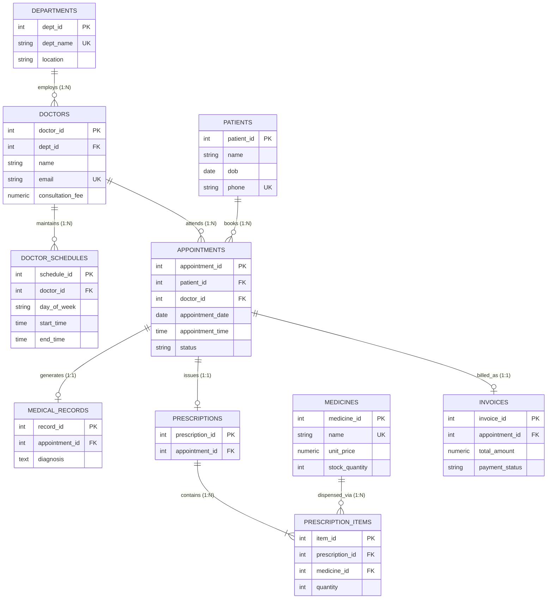

# MedConnect: Clinic Appointment Management System

[](https://github.com)
[](https://github.com)
[](https://www.postgresql.org/)
[-009688.svg)](https://fastapi.tiangolo.com/)
[](https://react.dev/)

---

## 1. Project Overview & Clinical Domain

**MedConnect** is a full-stack, database-centric healthcare management system engineered for multi-specialty outpatient clinics. Modern medical clinics face chronic operational bottlenecks: double-booked provider schedules, fragmented Electronic Health Records (EHR), inventory discrepancies in clinic dispensaries, and billing errors between clinical consultations and prescribed medications.

MedConnect grounds clinical workflows in a mathematically rigorous relational schema on **PostgreSQL 16**. It guarantees:
- **Zero Double-Booking:** Engine-enforced concurrency control via partial unique indexes and ACID row-level locking.
- **Atomic Pharmacy Inventory Management:** PL/pgSQL database triggers that automatically validate stock and decrement inventory upon prescription creation.
- **Automated Invoicing:** Stored procedures that consolidate doctor fees and prescription charges into an immutable billing record.
- **Administrative Intelligence:** Analytical views, Common Table Expressions (CTEs), and window functions for real-time departmental revenue and utilization reporting.

---

## 2. System Architecture & Technology Stack

The application follows a clean 3-tier architecture: `Frontend ↔ Application Backend ↔ Relational Database`.

```
┌────────────────────────────────────────────────────────────────────────┐
│                    CLIENT TIER: React 18 + Vite                        │
│  - Tailwind CSS + Lucide Icons                                         │
│  - Modular Portals: Patient Booking, Doctor Clinical, Admin Dashboard │
│  - TanStack Query (React Query) for caching & optimistic UI updates    │
└───────────────────────────────────┬────────────────────────────────────┘
                                    │ HTTP / REST (JSON)
                                    ▼
┌────────────────────────────────────────────────────────────────────────┐
│                  APPLICATION TIER: FastAPI (Python 3.11+)              │
│  - Asynchronous ASGI Framework (Uvicorn)                               │
│  - Strict Pydantic v2 runtime request validation & serialization       │
│  - Raw Parameterized SQL Execution via asyncpg connection pool         │
│  - JWT Bearer Authentication & Role-Based Middleware (RBAC)            │
└───────────────────────────────────┬────────────────────────────────────┘
                                    │ Native Connection Pool (Port 5432)
                                    ▼
┌────────────────────────────────────────────────────────────────────────┐
│                   DATABASE TIER: PostgreSQL 16                         │
│  - 10 Normalized Relations (1NF through BCNF compliant)                │
│  - ACID Transactions with Row-Level Locking (SELECT ... FOR UPDATE)    │
│  - Automated Triggers (Pharmacy stock deduction)                       │
│  - Stored Procedures (Encounter invoice calculation)                   │
│  - Analytical Views & Filtered Partial Unique Indexes                  │
└────────────────────────────────────────────────────────────────────────┘
```

### Architectural Philosophy: Raw Parameterized SQL vs. Heavy ORM
A cornerstone of this project is demonstrating authentic mastery of relational DBMS concepts. Heavy Object-Relational Mappers (such as Prisma or Hibernate) abstract SQL generation away into high-level methods (`db.appointment.findMany()`), obscuring query execution plans. 

MedConnect utilizes **raw parameterized SQL** via `asyncpg` / `psycopg3`:
- **SQL Injection Immunity:** Native parameter binding (`$1, $2, ...`).
- **Complete Control:** Direct formulation of multi-table joins, subqueries, CTEs, and window functions.
- **Viva Defense Transparency:** Every backend query maps directly to the relational design specification.

---

## 3. Database Schema Overview (10 Canonical Relations)

The schema defines **exactly 10 normalized relations**, strictly adhering to the academic guideline requirement of 8–12 tables ($8 \le 10 \le 12$).

| # | Relation (Table) | Entity Classification | Primary Key | Foreign Keys & Actions | Primary Purpose |
|---|---|---|---|---|---|
| 1 | **`Departments`** | Strong Entity | `dept_id` | None | Medical specialties (Cardiology, Dermatology, etc.) |
| 2 | **`Doctors`** | Strong Entity / Provider | `doctor_id` | `dept_id` $\to$ `Departments` (`RESTRICT`) | Healthcare practitioners, credentials, fees, and statuses |
| 3 | **`Doctor_Schedules`** | Dependent / Weak Entity | `schedule_id` | `doctor_id` $\to$ `Doctors` (`CASCADE`) | Weekly recurring shift availability windows |
| 4 | **`Patients`** | Strong Entity / Recipient | `patient_id` | None | Registered patient demographics and medical baseline |
| 5 | **`Appointments`** | Associative Entity | `appointment_id` | `patient_id` $\to$ `Patients` (`RESTRICT`)<br>`doctor_id` $\to$ `Doctors` (`RESTRICT`) | Scheduled consultations with partial index concurrency |
| 6 | **`Medical_Records`** | Dependent 1:1 Entity | `record_id` | `appointment_id` $\to$ `Appointments` (`SET NULL`, nullable)<br>`patient_id`, `doctor_id` (`RESTRICT`) | Clinical EHR documentation (symptoms, diagnosis, notes) |
| 7 | **`Prescriptions`** | Header 1:1 Entity | `prescription_id` | `appointment_id` $\to$ `Appointments` (`RESTRICT`)<br>`patient_id`, `doctor_id` (`RESTRICT`) | Medical orders issued during clinical consultation |
| 8 | **`Medicines`** | Strong Entity / Catalog | `medicine_id` | None | Pharmacy drug catalog, pricing, and stock inventory |
| 9 | **`Prescription_Items`** | Associative Bridge ($M:N$) | `item_id` | `prescription_id` $\to$ `Prescriptions` (`CASCADE`)<br>`medicine_id` $\to$ `Medicines` (`RESTRICT`) | Prescribed drug line items, dosages, and quantities |
| 10 | **`Invoices`** | Financial 1:1 Entity | `invoice_id` | `appointment_id` $\to$ `Appointments` (`RESTRICT`)<br>`patient_id` $\to$ `Patients` (`RESTRICT`) | Consolidated billing (consultation fees + pharmacy charges) |

### Conceptual ER Diagram



*For complete attribute catalogs, referential integrity cascades, and domain CHECK rules, see [`docs/database_design.md`](docs/database_design.md).*

---

## 4. Core Application Workflows & Advanced DBMS Features

### Workflow 1: ACID Appointment Booking with Concurrency Control
- **DBMS Feature:** Explicit Transaction Isolation (`READ COMMITTED`), Row-Level Locking (`SELECT ... FOR UPDATE`), and PostgreSQL Partial Unique Index:
  ```sql
  CREATE UNIQUE INDEX uq_doctor_slot_active 
  ON Appointments (doctor_id, appointment_date, appointment_time) 
  WHERE status NOT IN ('Cancelled');
  ```
- **Operational Guarantee:** If two concurrent requests attempt to book the identical slot, the second transaction is rejected by the database engine with unique constraint violation `23505`. The backend translates this into a clean HTTP 409 Conflict error. When an appointment is cancelled, the slot is immediately released for rebooking without deleting audit records.

### Workflow 2: Clinical Consultation & Trigger-Based Pharmacy Inventory Deduction
- **DBMS Feature:** PL/pgSQL Trigger (`BEFORE INSERT ON Prescription_Items`).
- **Operational Guarantee:** Intercepts prescription items, acquires row-level locks on `Medicines`, verifies sufficient inventory (`stock_quantity >= NEW.quantity`), and atomically decrements stock. If inventory is insufficient, the trigger raises an exception, aborting the entire prescription transaction.

### Workflow 3: Automated Invoicing & Administrative Analytics View
- **DBMS Feature:** Stored Procedure `sp_generate_invoice(p_appointment_id INT)` and Analytical View `v_daily_department_revenue`.
- **Operational Guarantee:** When a consultation concludes, the stored procedure dynamically aggregates the doctor's consultation fee and all dispensed medication line items, inserting an immutable invoice record. Clinic administrators query real-time revenue breakdowns by department directly through the view.

---

## 5. Architectural Decisions & Decision Log Summary

All major system choices and ambiguity resolutions are comprehensively recorded in [`decision.md`](decision.md):
- **Decision 1 (Database Engine):** Selected PostgreSQL 16 over MySQL/SQLite for native partial unique indexes, PL/pgSQL triggers, and advanced CTEs.
- **Decision 2 (Schema Scope):** Established 10 canonical tables to satisfy the 8–12 table guideline without bloat.
- **Decision 3 (Concurrency Control):** Combined partial unique indexes with transaction row locking for defense-in-depth collision prevention.
- **Decision 4 (Financial Immutability):** Snapshot pricing stored in `Invoices` to prevent retroactive accounting changes when catalog prices fluctuate.
- **Decision 5 (Automated Inventory):** PL/pgSQL trigger on `Prescription_Items` ensures zero phantom inventory.
- **Decision 6 (Tech Stack):** FastAPI (raw parameterized SQL) + React (Vite + Tailwind CSS).
- **Decision 7 (EHR Linkage):** Optional `appointment_id` on `Medical_Records` (with `ON DELETE SET NULL`) maintains clinical audit trails while supporting legacy records.
- **Decision 8 (PostgreSQL Constraint Dialect Compliance):** Replaced volatile functions (`CURRENT_DATE`, `CURRENT_TIMESTAMP`) in DDL `CHECK` constraints with static valid baseline checks (`date_of_birth >= '1900-01-01'`) and FastAPI Pydantic v2 application-layer validation, complying strictly with PostgreSQL 16 Section 5.4.1.
- **Ambiguity Resolutions:** Documented resolutions for mid-sem scope, cancellation rebooking, patient data confidentiality, dual team distributions, document pagination, and PostgreSQL volatile constraint prohibition.

---

## 6. Team Work Distribution Plans

To support individual viva evaluations (per Guidelines §4 & §8), explicit, balanced division of labor models are provided for both **4-person** and **5-person** team configurations.

---

### 6.1 Plan A: 4-Person Team Distribution

```
┌────────────────────────────────────────────────────────────────────────────────────────────────┐
│                                 4-PERSON TEAM ARCHITECTURE                                     │
├────────────────────────┬───────────────────────┬───────────────────────┬───────────────────────┤
│ Member 1 (Lead DBA)    │ Member 2 (Backend)    │ Member 3 (DBMS Spec)  │ Member 4 (Full-Stack) │
│ - Conceptual ER/EER    │ - FastAPI Setup       │ - Concurrency Txn     │ - React UI (Vite)     │
│ - 10-Table Schema DDL  │ - REST Endpoints      │ - Inventory Trigger   │ - Booking UI          │
│ - Normalization & Keys │ - Seed Data Pipeline  │ - Invoicing Procedure │ - Admin Dashboard     │
│ - Constraints & Doc    │ - DB Connection Pool  │ - 5 Complex Queries   │ - E2E Integration     │
└────────────────────────┴───────────────────────┴───────────────────────┴───────────────────────┘
```

#### Detailed Member Breakdown (4-Person Team)

| Team Member & Role | Mid-Sem Deliverables Owned | Post-Midsem Implementation Tasks | Individual Viva Defense Focus |
|---|---|---|---|
| **Member 1 (ID: XXXXX)**<br>*Lead Database Architect & DBA* | • Conceptual ER/EER diagram (Mermaid).<br>• 10-table relational schema mapping.<br>• Normalization proofs (1NF to BCNF).<br>• Integrity constraints catalog.<br>• Lead Editor: `docs/database_design.md`. | • PostgreSQL server configuration & schema migration management.<br>• Performance tuning and B-Tree index optimization.<br>• Table security and constraint verification. | • Formal normalization theory (1NF–BCNF).<br>• EER specialization/generalization hierarchies.<br>• Foreign key referential actions (`RESTRICT` vs `CASCADE`). |
| **Member 2 (ID: XXXXX)**<br>*Backend API Engineer & Data Lead* | • High-level application architecture.<br>• Tech stack evaluation.<br>• REST API specification (OpenAPI/Swagger).<br>• Initial repository configuration. | • FastAPI backend application implementation.<br>• Connection pool management (`asyncpg`).<br>• Synthetic data generation script (`seed.py`) with 500+ valid records.<br>• CRUD API routes for Patients, Doctors, and Departments. | • Parameterized SQL query execution.<br>• API design and connection pool scaling.<br>• Foreign key integrity during bulk data generation. |
| **Member 3 (ID: XXXXX)**<br>*Advanced DBMS Specialist* | • Workflow 1, 2, and 3 procedural flowcharts.<br>• Architectural Decision Log (`decision.md`).<br>• Procedural SQL specifications. | • Workflow 1: ACID booking transaction logic.<br>• Workflow 2: PL/pgSQL inventory trigger (`trg_deduct_medicine_stock`).<br>• Workflow 3: Invoicing stored procedure (`sp_generate_invoice`).<br>• 5 non-trivial SQL analytical queries (CTEs, window functions). | • Concurrency anomalies and isolation levels.<br>• Trigger execution lifecycle and exception handling.<br>• Window functions (`DENSE_RANK()`, `SUM() OVER ()`). |
| **Member 4 (ID: XXXXX)**<br>*Frontend UI & Integration Lead* | • UI wireframing and user journey mapping.<br>• Repository `README.md` authoring.<br>• Presentation slide preparation. | • React + Tailwind CSS client application implementation.<br>• Patient appointment booking calendar interface.<br>• Doctor clinical portal (EHR and prescriptions).<br>• Admin revenue and department analytics dashboard.<br>• End-to-end integration testing and viva demo readiness. | • Client-side state management and API integration.<br>• UX error handling (mapping 409 Conflict).<br>• System demonstration and user journey flows. |

#### RACI Matrix (4-Person Team)

| Project Deliverable / Module | Member 1 (DBA) | Member 2 (Backend) | Member 3 (DBMS Spec) | Member 4 (Frontend) |
|---|:---:|:---:|:---:|:---:|
| ER/EER Modeling & Schema DDL (`schema.sql`) | **A / R** | C | C | I |
| Normalization Proofs & Design Specification | **A / R** | I | C | I |
| Architectural Decision Log (`decision.md`) | C | C | **A / R** | I |
| FastAPI Backend Core & Connection Pool | I | **A / R** | C | C |
| Concurrency Booking Transaction & Locks | C | C | **A / R** | I |
| Inventory Trigger & Invoicing Procedure | C | I | **A / R** | I |
| 500+ Record Mock Data Seeding (`seed.py`) | C | **A / R** | I | I |
| 5 Non-Trivial SQL Analytical Queries | C | I | **A / R** | C |
| React Frontend Client & Clinical Portals | I | C | I | **A / R** |
| Repository `README.md` & Setup Guide | C | C | C | **A / R** |

*(Legend: **A** = Accountable, **R** = Responsible, **C** = Consulted, **I** = Informed)*

---

### 6.2 Plan B: 5-Person Team Distribution

```
┌──────────────────────────────────────────────────────────────────────────────────────────────────────────────────┐
│                                           5-PERSON TEAM ARCHITECTURE                                             │
├──────────────────────┬──────────────────────┬──────────────────────┬──────────────────────┬──────────────────────┤
│ Member 1 (DBA Lead)  │ Member 2 (API/W1)    │ Member 3 (DBMS/W2)   │ Member 4 (Frontend)  │ Member 5 (Analytics) │
│ - ER/EER Diagram     │ - FastAPI Framework  │ - Inventory Trigger  │ - React Components   │ - Admin Dashboard UI │
│ - 10-Table Schema    │ - Booking Txn & Lock │ - Invoicing Procedure│ - Booking Portal     │ - 5 Complex Queries  │
│ - Constraints & DDL  │ - Auth & Slot APIs   │ - Views & Triggers   │ - Doctor Prescribing │ - 500+ Faker Pipeline│
│ - Normalization Doc  │ - Backend Services   │ - Procedural SQL     │ - Responsive Styling │ - Testing & QA Lead  │
└──────────────────────┴──────────────────────┴──────────────────────┴──────────────────────┴──────────────────────┤
```

#### Detailed Member Breakdown (5-Person Team)

| Team Member & Role | Mid-Sem Deliverables Owned | Post-Midsem Implementation Tasks | Individual Viva Defense Focus |
|---|---|---|---|
| **Member 1 (ID: XXXXX)**<br>*Database Architect & Modeling Lead* | • Domain requirements analysis & business rules.<br>• Conceptual ER/EER diagram design (Mermaid).<br>• Relational schema mapping (10 tables).<br>• Normalization report (1NF through BCNF).<br>• Primary author of `docs/database_design.md`. | • PostgreSQL DDL maintenance & migration scripts.<br>• Table constraints, check rules, domain types.<br>• B-Tree indexing strategy & query plan auditing. | • Relational algebra and normalization theory.<br>• Lossless join decomposition proofs.<br>• Physical indexing tradeoffs. |
| **Member 2 (ID: XXXXX)**<br>*Backend API & Booking Workflow Lead* | • High-level application architecture.<br>• Workflow 1 (Booking & Concurrency) transaction logic.<br>• FastAPI project setup and OpenAPI documentation. | • Core REST API framework and connection pooling.<br>• Patient registration and doctor availability APIs.<br>• Workflow 1 implementation: ACID booking transaction with row-level locks and 409 Conflict handling. | • Transaction isolation levels in PostgreSQL.<br>• Row-level locking (`SELECT ... FOR UPDATE`).<br>• Race-condition prevention mechanisms. |
| **Member 3 (ID: XXXXX)**<br>*Advanced DBMS & Clinical Trigger Lead* | • Workflow 2 (Prescription & Inventory) business rules.<br>• Architectural decision logging (`decision.md`).<br>• Procedural SQL specifications. | • Workflow 2: PostgreSQL trigger for inventory deduction (`trg_deduct_medicine_stock`).<br>• Stored procedure for automated billing (`sp_generate_invoice`).<br>• Relational reporting views (`v_daily_department_revenue`). | • Trigger execution lifecycle (`BEFORE` vs `AFTER`).<br>• Exception handling in PL/pgSQL.<br>• Stored procedure parameter handling. |
| **Member 4 (ID: XXXXX)**<br>*Frontend UI & User Experience Lead* | • UI/UX wireframes and component hierarchy.<br>• Frontend project setup (React + Vite + Tailwind).<br>• User journey mapping for Patient and Doctor. | • Patient booking portal with dynamic calendar and available slot selection.<br>• Doctor clinical portal for consultation notes, diagnosis entry, and prescription generation.<br>• Frontend client state management and API integration. | • Component modularity and responsive UI.<br>• Client-side validation matching database constraints.<br>• End-to-end user experience flow. |
| **Member 5 (ID: XXXXX)**<br>*Analytics, Seed Data & QA Lead* | • Workflow 3 (Billing & Dashboard) query design.<br>• Test plan design and edge case cataloguing.<br>• Repository `README.md` authoring and maintenance. | • Synthetic data generation pipeline (Python `Faker`) generating 500+ records.<br>• 5 non-trivial SQL analytical queries (CTEs, window functions, JSON aggregation).<br>• Admin revenue & clinic operational dashboard.<br>• Automated test suite (`pytest`) validating transactions and constraints. | • Advanced SQL queries (CTEs, window functions).<br>• Performance testing and query optimization.<br>• Test coverage and edge-case verification. |

#### RACI Matrix (5-Person Team)

| Project Deliverable / Module | Member 1 (DBA) | Member 2 (API/W1) | Member 3 (DBMS/W2) | Member 4 (Frontend) | Member 5 (Analytics/QA) |
|---|:---:|:---:|:---:|:---:|:---:|
| ER/EER Diagram & Relational Schema | **A / R** | C | C | I | I |
| Database Design Document (`docs/`) | **A / R** | C | C | C | C |
| Decision Log (`decision.md`) | C | C | **A / R** | I | C |
| FastAPI Core & Workflow 1 (Booking) | I | **A / R** | C | C | I |
| Workflow 2 (Triggers & Invoicing) | C | C | **A / R** | I | I |
| React UI (Patient & Doctor Portals) | I | C | I | **A / R** | C |
| 500+ Mock Data Seeding (`seed.py`) | C | I | I | I | **A / R** |
| 5 Non-Trivial Analytical SQL Queries | C | I | C | I | **A / R** |
| Admin Analytics Dashboard | I | C | C | C | **A / R** |
| Repository `README.md` & Test Suite | C | C | C | C | **A / R** |

*(Legend: **A** = Accountable, **R** = Responsible, **C** = Consulted, **I** = Informed)*

---

## 7. Current Progress & Submission Checklist

### Mid-Semester Deliverables (Target: Oct 11) — Status: Complete
- [x] **Requirement R1 (Database & App Design):** Authored publication-grade [`docs/database_design.md`](docs/database_design.md) containing Mermaid ER/EER diagrams, 10-table relational schema, primary/foreign keys, comprehensive integrity constraints, normalization proofs (1NF–BCNF), workflows, and tech stack architecture.
- [x] **Requirement R2 (Decision Log):** Authored authoritative [`decision.md`](decision.md) detailing architecture trade-offs, tech stack selections, concurrency strategies, financial snapshot pricing, and resolutions for 5 explicit ambiguities.
- [x] **Requirement R3 (Work Distribution):** Fully defined distinct, viable work distribution plans, module ownership, and RACI matrices for both **4-Person** and **5-Person** team configurations.
- [x] **Requirement R4 (Repository Documentation):** Comprehensive update to `README.md` reflecting system overview, schema summary, workflows, decision summaries, and setup instructions.
- [x] **Companion DDL Script:** Delivered clean, syntax-verified PostgreSQL DDL script in [`schema.sql`](schema.sql) with 10 tables, partial unique index, B-tree indexes, inventory trigger, invoicing stored procedure, and revenue view.

### Post-Midsem Implementation Phase (Oct 12 – Nov 15) — Roadmap
- [ ] Implement `scripts/seed.py` generating 500+ realistic clinical records using Python `Faker`.
- [ ] Implement FastAPI backend application executing raw parameterized SQL queries with `asyncpg`.
- [ ] Implement React frontend application with Patient, Doctor, and Admin dashboards.
- [ ] Execute concurrency stress tests validating slot lock behavior under race conditions.
- [ ] Prepare live in-lab demonstration script and individual viva defense slide deck.

---

## 8. Database Setup & Verification Guide

### Prerequisites
- PostgreSQL 15 or 16 installed locally or running in Docker.
- (Optional for full stack) Python 3.11+, Node.js 18+.

### Executing the Schema Script
To initialize and verify the MedConnect database on PostgreSQL:

```bash
# 1. Create the database
createdb -U postgres medconnect_db

# 2. Execute the DDL companion script
psql -U postgres -d medconnect_db -f schema.sql
```

The script will:
1. Drop existing objects cleanly (`DROP ... CASCADE`).
2. Construct all 10 tables with exact types, defaults, and domain constraints (including static valid baseline check `chk_patient_dob_valid`).
3. Build all primary keys, foreign keys with referential actions (including nullable `Medical_Records.appointment_id` with `ON DELETE SET NULL`), and performance indexes.
4. Build the partial unique index `uq_doctor_slot_active` on `Appointments`.
5. Compile the PL/pgSQL trigger function `fn_trg_deduct_medicine_stock()` and bind the trigger `trg_deduct_medicine_stock`.
6. Compile the stored procedure `sp_generate_invoice(INT)` with precondition status verification (`v_appt_status = 'Completed'`).
7. Construct the analytical database view `v_daily_department_revenue` filtered on settled invoices (`WHERE payment_status = 'Paid'`).

---

## 9. Viva Defense Preparation Notes

Every team member will undergo an individual viva defense (Guidelines §4 & §8). Below are key oral examination questions and answers anchored in MedConnect's architecture:

1. **Why is your schema in BCNF?**
   - In all 10 relations, the determinant (left-hand side) of every non-trivial functional dependency is a candidate key (superkey). 
   - Transitive dependencies are eliminated (e.g., department attributes are stored in `Departments`, not duplicated in `Doctors` or `Appointments`).
2. **How does MedConnect prevent doctor double-booking during concurrent requests?**
   - We utilize a **PostgreSQL Partial Unique Index**:
     `CREATE UNIQUE INDEX uq_doctor_slot_active ON Appointments (doctor_id, appointment_date, appointment_time) WHERE status != 'Cancelled';`
   - In conjunction with `READ COMMITTED` transaction isolation and row locks, this mathematically prevents slot collisions at the engine level while allowing cancelled slots to be immediately rebooked without deleting data.
3. **Why do Invoices store consultation fees and medicine totals if they exist in other tables?**
   - This is an intentional **Financial Audit Snapshot Pattern**. Master medicine prices and doctor fees change over time. Storing historical snapshot fees preserves legal billing immutability so that updating a drug's price in the future does not retroactively alter previously paid invoices.
4. **How does the inventory trigger protect pharmacy stocks?**
   - `trg_deduct_medicine_stock` fires `BEFORE INSERT` on `Prescription_Items`. It acquires a row-level lock on `Medicines`, verifies `stock_quantity >= NEW.quantity`, and decrements stock. If stock is insufficient, it raises an exception, automatically rolling back the entire prescription transaction.

---

*MedConnect is developed for the CS Database Management Systems (DBMS) Course Project.*
