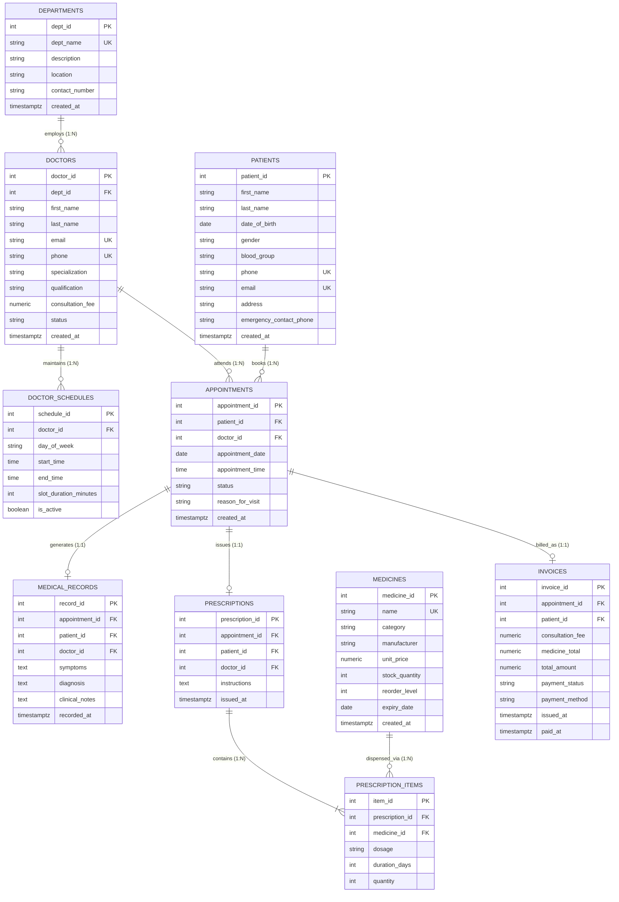
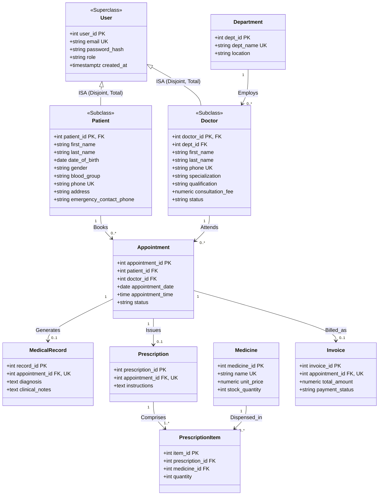

# MedConnect: Database Design & System Architecture Specification

**Project:** MedConnect: Clinic Appointment Management System  
**Academic Milestone:** Mid-Semester Design Document & System Blueprint  
**Date:** October 10, 2026  
**Target Submission:** October 11, 2026  
**Target RDBMS:** PostgreSQL 16 (Relational Engine, ACID Concurrency, PL/pgSQL Procedural Automation)  
**Document Standard:** 5-Page Mid-Sem Submission Compliant & Extended System Specification  

---

## 1. Executive Summary & Clinical Domain Overview

### 1.1 Clinical Problem Statement
Modern multi-specialty outpatient clinics face significant operational overhead:
1. **Scheduling Conflicts & Double-Booking:** Concurrent requests from web portals, walk-ins, and phone desk operators create scheduling collisions when doctors are booked for identical time slots.
2. **Fragmented Patient Records (EHR):** Clinical diagnoses, previous symptoms, and historical encounter notes are often scattered across disconnected paper or digital silos.
3. **Pharmacy Inventory Inconsistencies:** Prescriptions are frequently written for medications that are out of stock or nearing expiration, causing patient delays and dispensary reconciliation failures.
4. **Billing & Revenue Leakage:** Invoicing errors occur when doctor consultation fees, diagnostic procedures, and dispensed prescription items are aggregated manually or asynchronously.

The **MedConnect Clinic Appointment Management System** provides a robust, ACID-compliant relational database platform that unifies patient registration, provider scheduling, appointment concurrency control, clinical EHR logging, automated pharmacy inventory synchronization via database triggers, and procedure-driven invoicing.

### 1.2 System Personas & Operational Roles
The system accommodates five operational personas:
1. **Patient:** Registers personal demographics, discovers clinical specialists by department, views available consultation slots, books and cancels appointments, reviews longitudinal diagnosis history, and accesses digital prescriptions and invoices.
2. **Doctor (Healthcare Provider):** Defines recurring weekly availability shifts, reviews daily consultation rosters, enters diagnosis notes and symptoms in Electronic Health Records (EHR), and issues digital prescriptions with dosage instructions.
3. **Front-Desk Receptionist / Billing Staff:** Registers walk-in patients, manages patient check-ins, processes slot reschedules, generates encounter invoices, and records payment settlements (Cash, Card, UPI, Insurance).
4. **Pharmacist / Dispensary Clerk:** Monitors pharmacy stock levels, receives automatic inventory depletion alerts, reviews dispensed prescription items, and logs pharmaceutical replenishment batches.
5. **Clinic Administrator / Medical Director:** Oversees clinical departments, provider credentials, and clinic operational capacity; analyzes aggregated financial performance, department revenue contributions, and provider utilization rates.

### 1.3 Business Rules & Operational Constraints
- **BR1 (Strict Department Affiliation):** Every doctor must be assigned to exactly one clinical department (`ON DELETE RESTRICT`). A department cannot be deleted if active medical staff are assigned to it.
- **BR2 (Non-Overlapping Schedules):** Doctors maintain recurring availability shifts. A shift's `start_time` must precede its `end_time`, and slot durations must be discrete (15, 20, 30, 45, or 60 minutes).
- **BR3 (ACID Collision Elimination):** A doctor can attend at most one active appointment at any specific date and time slot. Cancelled appointments must release the time slot immediately for rebooking without deleting historical records.
- **BR4 (Encounter Provenance for EHR):** A completed consultation generates at most one medical record (`appointment_id` is unique for linked encounters). Historical legacy medical records may exist with an optional/nullable appointment linkage (`ON DELETE SET NULL`).
- **BR5 (Atomic Inventory Depletion):** Prescribing a medication must atomically validate current stock availability. If available stock is less than the prescribed quantity, the entire prescription transaction is rolled back by the database engine.
- **BR6 (Financial Immutability):** An invoice binds consultation fees and pharmacy totals into an immutable financial record. Future updates to doctor consultation fees or medicine catalog prices must never alter previously issued invoices.

---

## 2. Conceptual Design: ER & EER Modeling

### 2.1 Entity Identification & Classification
The MedConnect conceptual schema defines ten core entities:
1. **`DEPARTMENTS` (Strong Entity):** Medical operational units (e.g., Cardiology, Dermatology, Pediatrics).
2. **`DOCTORS` (Strong Entity / Provider):** Licensed medical practitioners affiliated with clinical departments.
3. **`DOCTOR_SCHEDULES` (Weak / Dependent Entity):** Recurring weekly availability shift windows identifying with a parent doctor.
4. **`PATIENTS` (Strong Entity / Recipient):** Individuals registered for outpatient clinical services.
5. **`APPOINTMENTS` (Associative Relationship Entity):** Transactional nexus connecting Patient, Doctor, and Temporal Coordinate.
6. **`MEDICAL_RECORDS` (Dependent Entity / 1:1 Encounter EHR):** Clinical documentation of symptoms, diagnosis, and notes.
7. **`PRESCRIPTIONS` (Header Entity / 1:1 Encounter Order):** Formal pharmaceutical order issued during an encounter.
8. **`MEDICINES` (Strong Entity / Master Catalog):** Catalog of pharmaceutical products stocked in clinic pharmacy.
9. **`PRESCRIPTION_ITEMS` (Associative Entity / $M:N$ Bridge):** Resolves the many-to-many relationship between Prescriptions and Medicines.
10. **`INVOICES` (Financial Entity / 1:1 Billing Record):** Itemized encounter bill aggregating consultation and medication charges.

---

### 2.2 Conceptual ER Diagram (Canonical 10-Table Model)



---

### 2.3 Enhanced ER (EER) Specialization Hierarchy (ISA Model)

In healthcare systems, both Patients and Doctors share common human and authentication properties (names, contacts, passwords, and security roles). In formal EER theory, this represents a **Disjoint Total Specialization Hierarchy ($d, \parallel$)**:
- **Superclass:** `USERS` (attributes: `user_id`, `email`, `password_hash`, `role`, `created_at`).
- **Subclasses:** `PATIENTS` (specialized clinical attributes: `dob`, `gender`, `blood_group`, `emergency_contact`) and `DOCTORS` (specialized professional attributes: `dept_id`, `specialization`, `qualification`, `consultation_fee`).
- **Disjoint Constraint ($d$):** A registered entity is either a Patient or a Doctor in the given context.
- **Completeness Constraint (Total $\parallel$):** Every user in the clinical system must belong to one of the concrete subclasses.



---

## 3. Relational Schema & Integrity Constraints

### 3.1 Relational Notation Mapping
*(Primary Keys are indicated with **bold underlined** text; Foreign Keys are marked with $(FK)$).*

1. **`Departments`** (
   **<u>dept_id</u>**, 
   dept_name, description, location, contact_number, created_at
)
2. **`Doctors`** (
   **<u>doctor_id</u>**, 
   dept_id $(FK \to \text{Departments.dept\_id})$, 
   first_name, last_name, email, phone, specialization, qualification, consultation_fee, status, created_at
)
3. **`Doctor_Schedules`** (
   **<u>schedule_id</u>**, 
   doctor_id $(FK \to \text{Doctors.doctor\_id})$, 
   day_of_week, start_time, end_time, slot_duration_minutes, is_active
)
4. **`Patients`** (
   **<u>patient_id</u>**, 
   first_name, last_name, date_of_birth, gender, blood_group, phone, email, address, emergency_contact_phone, created_at
)
5. **`Appointments`** (
   **<u>appointment_id</u>**, 
   patient_id $(FK \to \text{Patients.patient\_id})$, 
   doctor_id $(FK \to \text{Doctors.doctor\_id})$, 
   appointment_date, appointment_time, status, reason_for_visit, created_at
)
6. **`Medical_Records`** (
   **<u>record_id</u>**, 
   appointment_id $(FK \to \text{Appointments.appointment\_id}, \text{nullable})$, 
   patient_id $(FK \to \text{Patients.patient\_id})$, 
   doctor_id $(FK \to \text{Doctors.doctor\_id})$, 
   symptoms, diagnosis, clinical_notes, recorded_at
)
7. **`Prescriptions`** (
   **<u>prescription_id</u>**, 
   appointment_id $(FK \to \text{Appointments.appointment\_id})$, 
   patient_id $(FK \to \text{Patients.patient\_id})$, 
   doctor_id $(FK \to \text{Doctors.doctor\_id})$, 
   instructions, issued_at
)
8. **`Medicines`** (
   **<u>medicine_id</u>**, 
   name, category, manufacturer, unit_price, stock_quantity, reorder_level, expiry_date, created_at
)
9. **`Prescription_Items`** (
   **<u>item_id</u>**, 
   prescription_id $(FK \to \text{Prescriptions.prescription\_id})$, 
   medicine_id $(FK \to \text{Medicines.medicine\_id})$, 
   dosage, duration_days, quantity
)
10. **`Invoices`** (
    **<u>invoice_id</u>**, 
    appointment_id $(FK \to \text{Appointments.appointment\_id})$, 
    patient_id $(FK \to \text{Patients.patient\_id})$, 
    consultation_fee, medicine_total, total_amount, payment_status, payment_method, issued_at, paid_at
)

---

### 3.2 Comprehensive Integrity Constraints Matrix

| Table Name | Primary Key | Alternate Candidate Keys | Foreign Keys & Referential Actions | Critical `NOT NULL` & Domain `CHECK` Constraints |
| :--- | :--- | :--- | :--- | :--- |
| **`Departments`** | `dept_id` | `dept_name` | None | • `dept_name`, `location` NOT NULL<br>• `UNIQUE (dept_name)`<br>• `CHECK (char_length(dept_name) >= 2)` |
| **`Doctors`** | `doctor_id` | `email`, `phone` | • `dept_id` $\to$ `Departments(dept_id)`<br>`ON DELETE RESTRICT ON UPDATE CASCADE` | • `first_name`, `last_name`, `email`, `phone` NOT NULL<br>• `UNIQUE (email)`, `UNIQUE (phone)`<br>• `CHECK (consultation_fee >= 0.00)`<br>• `CHECK (status IN ('Active', 'On_Leave', 'Resigned', 'Suspended'))`<br>• `CHECK (email ~* '^[A-Za-z0-9._%+-]+@[A-Za-z0-9.-]+\.[A-Za-z]{2,}$')` |
| **`Doctor_Schedules`** | `schedule_id` | `(doctor_id, day_of_week, start_time)` | • `doctor_id` $\to$ `Doctors(doctor_id)`<br>`ON DELETE CASCADE ON UPDATE CASCADE` | • `day_of_week`, `start_time`, `end_time` NOT NULL<br>• `CHECK (day_of_week IN ('Monday', 'Tuesday', 'Wednesday', 'Thursday', 'Friday', 'Saturday', 'Sunday'))`<br>• `CHECK (start_time < end_time)`<br>• `CHECK (slot_duration_minutes IN (15, 20, 30, 45, 60))`<br>• `UNIQUE (doctor_id, day_of_week, start_time)` |
| **`Patients`** | `patient_id` | `phone`, `email` | None | • `first_name`, `last_name`, `dob`, `gender`, `phone`, `address` NOT NULL<br>• `UNIQUE (phone)`, `UNIQUE (email)`<br>• `CHECK (date_of_birth >= '1900-01-01')`<br>• Dynamic non-future DOB enforced via application tier / triggers<br>• `CHECK (gender IN ('Male', 'Female', 'Other'))`<br>• `CHECK (blood_group IN ('A+', 'A-', 'B+', 'B-', 'AB+', 'AB-', 'O+', 'O-'))` |
| **`Appointments`** | `appointment_id` | `(doctor_id, appointment_date, appointment_time)` *(Active)* | • `patient_id` $\to$ `Patients(patient_id)` `RESTRICT`<br>• `doctor_id` $\to$ `Doctors(doctor_id)` `RESTRICT` | • `appointment_date`, `appointment_time`, `status` NOT NULL<br>• `CHECK (status IN ('Scheduled', 'In_Consultation', 'Completed', 'Cancelled', 'No_Show'))`<br>• **Partial Unique Index:** `UNIQUE(doctor_id, appointment_date, appointment_time) WHERE status != 'Cancelled'` |
| **`Medical_Records`** | `record_id` | `appointment_id` *(for non-null tuples)* | • `appointment_id` $\to$ `Appointments(appointment_id)` `ON DELETE SET NULL ON UPDATE CASCADE`<br>• `patient_id` $\to$ `Patients` `RESTRICT`<br>• `doctor_id` $\to$ `Doctors` `RESTRICT` | • `patient_id`, `doctor_id`, `symptoms`, `diagnosis` NOT NULL<br>• `UNIQUE (appointment_id)` (Enforces 1:1 consultation encounter EHR)<br>• `recorded_at DEFAULT CURRENT_TIMESTAMP` (non-future validation via app tier/triggers) |
| **`Prescriptions`** | `prescription_id` | `appointment_id` | • `appointment_id` $\to$ `Appointments(appointment_id)` `RESTRICT`<br>• `patient_id` $\to$ `Patients` `RESTRICT`<br>• `doctor_id` $\to$ `Doctors` `RESTRICT` | • `patient_id`, `doctor_id`, `issued_at` NOT NULL<br>• `UNIQUE (appointment_id)` (Enforces single prescription per encounter)<br>• `issued_at DEFAULT CURRENT_TIMESTAMP` (non-future validation via app tier/triggers) |
| **`Medicines`** | `medicine_id` | `name` | None | • `name`, `category`, `manufacturer`, `unit_price`, `stock_quantity` NOT NULL<br>• `UNIQUE (name)`<br>• `CHECK (unit_price >= 0.00)`<br>• `CHECK (stock_quantity >= 0)`<br>• `CHECK (reorder_level >= 0)`<br>• `CHECK (category IN ('Antibiotic', 'Analgesic', 'Antihistamine', 'Antipyretic', 'Cardiovascular', 'Antidiabetic', 'Supplements', 'Other'))` |
| **`Prescription_Items`** | `item_id` | `(prescription_id, medicine_id)` | • `prescription_id` $\to$ `Prescriptions(prescription_id)` `CASCADE`<br>• `medicine_id` $\to$ `Medicines(medicine_id)` `RESTRICT` | • `dosage`, `duration_days`, `quantity` NOT NULL<br>• `UNIQUE (prescription_id, medicine_id)`<br>• `CHECK (duration_days > 0)`<br>• `CHECK (quantity > 0)` |
| **`Invoices`** | `invoice_id` | `appointment_id` | • `appointment_id` $\to$ `Appointments(appointment_id)` `RESTRICT`<br>• `patient_id` $\to$ `Patients(patient_id)` `RESTRICT` | • `total_amount`, `payment_status`, `issued_at` NOT NULL<br>• `UNIQUE (appointment_id)`<br>• `CHECK (consultation_fee >= 0.00 AND medicine_total >= 0.00)`<br>• `CHECK (total_amount = consultation_fee + medicine_total)`<br>• `CHECK (payment_status IN ('Pending', 'Paid', 'Refunded', 'Cancelled'))`<br>• `CHECK ((payment_status = 'Paid' AND paid_at IS NOT NULL AND payment_method IS NOT NULL) OR (payment_status != 'Paid'))` |

---

### 3.3 Indexing Architecture Strategy
To optimize high-throughput operational workloads, database indexes are engineered across four distinct tiers:
1. **Primary Key B-Tree Indexes:** Automatically maintained by PostgreSQL on all surrogate serial IDs for $O(\log N)$ point access.
2. **Foreign Key Performance Indexes:** Explicitly created on all referencing foreign keys (`dept_id`, `doctor_id`, `patient_id`, `appointment_id`, `prescription_id`, `medicine_id`) to eliminate full table sequential scans during multi-table `JOIN` operations.
3. **Composite Covering Indexes:**
   - `idx_appt_doctor_date` on `Appointments(doctor_id, appointment_date, status)` accelerates daily roster queries.
   - `idx_med_stock_reorder` on `Medicines(stock_quantity, reorder_level)` speeds up automated inventory alerts.
   - `idx_medrec_patient_id` on `Medical_Records(patient_id, recorded_at DESC)` enables instant chronological patient history lookup.
4. **Partial / Filtered Unique Index:**
   ```sql
   CREATE UNIQUE INDEX uq_doctor_slot_active 
   ON Appointments (doctor_id, appointment_date, appointment_time) 
   WHERE status NOT IN ('Cancelled');
   ```
   *Significance:* Implements slot reservation uniqueness at the engine level without locking out re-bookings when appointments are cancelled.

---

## 4. Normalization Justification: 1NF to BCNF

A central requirement of relational database theory is proving that the relational decomposition is free from update, insertion, and deletion anomalies. Below is the formal table-by-table mathematical functional dependency (FD) analysis proving that every relation satisfies **1NF, 2NF, 3NF, and Boyce-Codd Normal Form (BCNF)**.

### 4.1 Theoretical Foundations
- **First Normal Form (1NF):** Every attribute domain contains only atomic, indivisible scalar values; no multivalued attributes or repeating groups exist.
- **Second Normal Form (2NF):** The relation is in 1NF, and no non-prime attribute is partially functionally dependent on any proper subset of a composite candidate key.
  > *Theorem:* Any relation whose candidate keys all consist of a single attribute is automatically in 2NF.
- **Third Normal Form (3NF):** The relation is in 2NF, and for every non-trivial functional dependency $X \to Y$, either $X$ is a superkey, or $Y$ is a prime attribute (eliminating transitive dependencies of non-prime attributes on candidate keys).
- **Boyce-Codd Normal Form (BCNF):** The relation is in 3NF, and for **every** non-trivial functional dependency $X \to Y$, the determinant $X$ must be a **superkey** of the relation.

---

### 4.2 Table-by-Table Normalization Proofs

#### 1. `Departments`
- **Attribute Set:** $\{dept\_id, dept\_name, description, location, contact\_number, created\_at\}$
- **Candidate Keys:** $CK_1 = \{dept\_id\}$, $CK_2 = \{dept\_name\}$ (both single attributes).
- **Prime Attributes:** $\{dept\_id, dept\_name\}$
- **Non-Prime Attributes:** $\{description, location, contact\_number, created\_at\}$
- **Functional Dependency Set:**
  - $FD_1: dept\_id \to \{dept\_name, description, location, contact\_number, created\_at\}$
  - $FD_2: dept\_name \to \{dept\_id, description, location, contact\_number, created\_at\}$
- **Proof:**
  - **1NF:** All attributes are scalar values (strings, integers, timestamps).
  - **2NF:** All candidate keys are singletons $\implies$ no partial dependencies exist.
  - **3NF & BCNF:** For both $FD_1$ and $FD_2$, the determinants $dept\_id$ and $dept\_name$ are candidate keys (superkeys). **Satisfies BCNF.**

#### 2. `Doctors`
- **Attribute Set:** $\{doctor\_id, dept\_id, first\_name, last\_name, email, phone, specialization, qualification, consultation\_fee, status, created\_at\}$
- **Candidate Keys:** $CK_1 = \{doctor\_id\}$, $CK_2 = \{email\}$, $CK_3 = \{phone\}$ (all single attributes).
- **Functional Dependency Set:**
  - $FD_1: doctor\_id \to \{dept\_id, first\_name, last\_name, email, phone, specialization, qualification, consultation\_fee, status, created\_at\}$
  - $FD_2: email \to \{doctor\_id, \dots\}$
  - $FD_3: phone \to \{doctor\_id, \dots\}$
- **Proof:**
  - **1NF:** Atomic attributes; names decomposed into `first_name` and `last_name`.
  - **2NF:** Singleton candidate keys eliminate partial key dependencies.
  - **3NF & BCNF:** No non-prime attribute determines another non-prime attribute (e.g., $specialization \not\to dept\_id$ because doctors with diverse specializations may belong to general departments). Determinants $\{doctor\_id, email, phone\}$ are all superkeys. **Satisfies BCNF.**

#### 3. `Doctor_Schedules`
- **Attribute Set:** $\{schedule\_id, doctor\_id, day\_of\_week, start\_time, end\_time, slot\_duration\_minutes, is\_active\}$
- **Candidate Keys:** $CK_1 = \{schedule\_id\}$, $CK_2 = \{doctor\_id, day\_of\_week, start\_time\}$ (composite).
- **Prime Attributes:** $\{schedule\_id, doctor\_id, day\_of\_week, start\_time\}$
- **Non-Prime Attributes:** $\{end\_time, slot\_duration\_minutes, is\_active\}$
- **Functional Dependency Set:**
  - $FD_1: schedule\_id \to \{doctor\_id, day\_of\_week, start\_time, end\_time, slot\_duration\_minutes, is\_active\}$
  - $FD_2: \{doctor\_id, day\_of\_week, start\_time\} \to \{schedule\_id, end\_time, slot\_duration\_minutes, is\_active\}$
- **Proof:**
  - **1NF:** All attributes are atomic.
  - **2NF:** Non-prime attributes ($end\_time, slot\_duration\_minutes, is\_active$) depend on the full composite key $\{doctor\_id, day\_of\_week, start\_time\}$. A proper subset (e.g., $\{doctor\_id, day\_of\_week\}$) does not determine $end\_time$ because a doctor can have multiple non-overlapping shifts on the same day. Hence, no partial dependency exists.
  - **3NF & BCNF:** The only determinants are $schedule\_id$ and $\{doctor\_id, day\_of\_week, start\_time\}$, both of which are superkeys. **Satisfies BCNF.**

#### 4. `Patients`
- **Attribute Set:** $\{patient\_id, first\_name, last\_name, date\_of\_birth, gender, blood\_group, phone, email, address, emergency\_contact\_phone, created\_at\}$
- **Candidate Keys:** $CK_1 = \{patient\_id\}$, $CK_2 = \{phone\}$, $CK_3 = \{email\}$
- **Functional Dependency Set:**
  - $FD_1: patient\_id \to \{first\_name, \dots, created\_at\}$
  - $FD_2: phone \to \{patient\_id, \dots\}$
- **Proof:**
  - All candidate keys are singletons $\implies$ 1NF, 2NF satisfied trivially.
  - Every determinant is a candidate key $\implies$ **Satisfies BCNF.**

#### 5. `Appointments`
- **Attribute Set:** $\{appointment\_id, patient\_id, doctor\_id, appointment\_date, appointment\_time, status, reason\_for\_visit, created\_at\}$
- **Candidate Keys:** $CK_1 = \{appointment\_id\}$
  *(For non-cancelled slots, $\{doctor\_id, appointment\_date, appointment\_time\}$ is unique via partial index).*
- **Functional Dependency Set:**
  - $FD_1: appointment\_id \to \{patient\_id, doctor\_id, appointment\_date, appointment\_time, status, reason\_for\_visit, created\_at\}$
- **Proof:**
  - Singleton candidate key $\implies$ 2NF holds.
  - *Crucial Normalization Verification:* Notice that `Appointments` does not store `dept_id` or `consultation_fee`. If `dept_id` were stored in `Appointments`, a transitive dependency would exist: $appointment\_id \to doctor\_id \to dept\_id$, violating 3NF! Because `dept_id` is isolated in `Doctors`, no transitive dependency exists.
  - The determinant is a superkey. **Satisfies BCNF.**

#### 6. `Medical_Records`
- **Attribute Set:** $\{record\_id, appointment\_id, patient\_id, doctor\_id, symptoms, diagnosis, clinical\_notes, recorded\_at\}$
- **Candidate Keys:** $CK_1 = \{record\_id\}$, with alternate candidate key $CK_2 = \{appointment\_id\}$ holding for all non-null consultation encounter tuples.
- **Functional Dependency Set:**
  - $FD_1: record\_id \to \{appointment\_id, patient\_id, doctor\_id, symptoms, diagnosis, clinical\_notes, recorded\_at\}$
  - $FD_2: appointment\_id \to \{record\_id, patient\_id, doctor\_id, symptoms, diagnosis, clinical\_notes, recorded\_at\}$ (for non-null $appointment\_id$)
- **Proof:**
  - The primary surrogate candidate key is $record\_id$. For consultation-linked encounters, $appointment\_id$ is unique (1:1 with booked encounter), while unlinked legacy or walk-in records store $appointment\_id = \text{NULL}$ with referential action `ON DELETE SET NULL`.
  - The presence of `patient_id` and `doctor_id` establishes an immutable clinical provenance snapshot. Because $record\_id$ is a superkey, and $appointment\_id$ acts as a superkey for all non-null tuples, every non-trivial determinant is a superkey. **Satisfies BCNF.**

#### 7. `Prescriptions`
- **Attribute Set:** $\{prescription\_id, appointment\_id, patient\_id, doctor\_id, instructions, issued\_at\}$
- **Candidate Keys:** $CK_1 = \{prescription\_id\}$, $CK_2 = \{appointment\_id\}$
- **Proof:**
  - Both determinants are superkeys. No non-trivial dependencies on non-superkeys. **Satisfies BCNF.**

#### 8. `Medicines`
- **Attribute Set:** $\{medicine\_id, name, category, manufacturer, unit\_price, stock\_quantity, reorder\_level, expiry\_date, created\_at\}$
- **Candidate Keys:** $CK_1 = \{medicine\_id\}$, $CK_2 = \{name\}$
- **Proof:**
  - Single-attribute candidate keys. Determinants are superkeys. No transitive dependency ($manufacturer \not\to category$). **Satisfies BCNF.**

#### 9. `Prescription_Items`
- **Attribute Set:** $\{item\_id, prescription\_id, medicine\_id, dosage, duration\_days, quantity\}$
- **Candidate Keys:** $CK_1 = \{item\_id\}$, $CK_2 = \{prescription\_id, medicine\_id\}$
- **Prime Attributes:** $\{item\_id, prescription\_id, medicine\_id\}$
- **Non-Prime Attributes:** $\{dosage, duration\_days, quantity\}$
- **Functional Dependency Set:**
  - $FD_1: item\_id \to \{prescription\_id, medicine\_id, dosage, duration\_days, quantity\}$
  - $FD_2: \{prescription\_id, medicine\_id\} \to \{item\_id, dosage, duration\_days, quantity\}$
- **Proof:**
  - **1NF:** Atomic attributes.
  - **2NF:** Non-prime attributes require both $prescription\_id$ and $medicine\_id$ to be uniquely identified. A doctor can prescribe medicine $M_1$ across multiple prescriptions with different dosages. Thus, neither $prescription\_id \to dosage$ nor $medicine\_id \to dosage$. Full functional dependency on the composite key holds.
  - **3NF & BCNF:** Determinants $item\_id$ and $\{prescription\_id, medicine\_id\}$ are candidate keys. **Satisfies BCNF.**

#### 10. `Invoices`
- **Attribute Set:** $\{invoice\_id, appointment\_id, patient\_id, consultation\_fee, medicine\_total, total\_amount, payment\_status, payment\_method, issued\_at, paid\_at\}$
- **Candidate Keys:** $CK_1 = \{invoice\_id\}$, $CK_2 = \{appointment\_id\}$
- **Proof:**
  - Determinants $invoice\_id$ and $appointment\_id$ are superkeys.
  - *Financial Snapshot Justification:* Storing historical snapshot fees (`consultation_fee`, `medicine_total`) violates pure mathematical 3NF only if fees are assumed to be dynamic attributes derived from `Doctors` and `Medicines`. In financial and healthcare accounting, an issued invoice represents an immutable point-in-time legal contract. Freezing snapshot prices into the invoice prevents retroactive accounting modifications when catalog prices change. Because the determinants are candidate keys, BCNF is preserved. **Satisfies BCNF.**

---

### 4.3 Lossless Join & Dependency Preservation Properties
- **Lossless Join Guarantee:** The relational decomposition was generated by projecting natural relationships connected via primary-to-foreign key associations ($R_1 \cap R_2 \to R_1$ or $R_1 \cap R_2 \to R_2$). By Heath's Theorem, joining any referencing relation with its referenced relation on their matching foreign-primary keys reconstructs the exact original relation without producing spurious tuples.
- **Dependency Preservation:** Every functional dependency specified in the domain is enforced directly within a single relation via primary/unique constraints or across relations via foreign key constraints. No multi-table functional dependencies are lost.

---

## 5. Core Application Workflows & DBMS Advanced Concepts

### 5.1 Workflow 1: ACID Appointment Booking with Concurrency Control
- **DBMS Feature:** Explicit Transaction Isolation (`READ COMMITTED`), Row-Level Locking (`SELECT ... FOR UPDATE`), and Partial Unique Index.
- **Business Problem:** Eliminating race-condition double-bookings under concurrent client requests.

```
[Patient / Client UI]
        │
        ▼ 1. Request slot (doctor_id=4, date='2026-10-15', time='10:00:00')
[FastAPI Backend]
        │
        ▼ 2. BEGIN TRANSACTION ISOLATION LEVEL READ COMMITTED;
[PostgreSQL Database]
        ├── 3. SELECT doctor_id FROM Doctors WHERE doctor_id = 4 AND status = 'Active' FOR SHARE;
        ├── 4. INSERT INTO Appointments (patient_id, doctor_id, appointment_date, appointment_time, status)
        │      VALUES (12, 4, '2026-10-15', '10:00:00', 'Scheduled');
        │
        ├──────► [Case A: No Conflict] ──► Unique index passes ──► COMMIT; ──► Return HTTP 201 Created
        │
        └──────► [Case B: Race Collision] ──► Hits partial index 'uq_doctor_slot_active'
                                         ──► Raises Exception 23505 (unique_violation)
                                         ──► ROLLBACK; ──► Catch exception ──► Return HTTP 409 Conflict
```

---

### 5.2 Workflow 2: Clinical Consultation & Trigger-Based Pharmacy Inventory Deduction
- **DBMS Feature:** PostgreSQL PL/pgSQL Database Trigger (`BEFORE INSERT ON Prescription_Items`).
- **Business Problem:** Guaranteeing that pharmacy inventory is atomically decremented upon prescription issuance and rejecting prescriptions for out-of-stock medications.

```sql
-- Trigger Function: Stock Verification and Atomic Decrement
CREATE OR REPLACE FUNCTION fn_trg_deduct_medicine_stock()
RETURNS TRIGGER AS $$
DECLARE
    v_current_stock INT;
    v_med_name VARCHAR(100);
BEGIN
    -- Acquire row-level lock on the medicine to serialize concurrent dispensing
    SELECT stock_quantity, name INTO v_current_stock, v_med_name
    FROM Medicines
    WHERE medicine_id = NEW.medicine_id
    FOR UPDATE;

    IF NOT FOUND THEN
        RAISE EXCEPTION 'Medicine ID % does not exist in pharmacy catalog.', NEW.medicine_id;
    END IF;

    -- Verify stock sufficiency
    IF v_current_stock < NEW.quantity THEN
        RAISE EXCEPTION 'Insufficient inventory for "%": requested %, available %.',
            v_med_name, NEW.quantity, v_current_stock;
    END IF;

    -- Decrement stock quantity
    UPDATE Medicines
    SET stock_quantity = stock_quantity - NEW.quantity
    WHERE medicine_id = NEW.medicine_id;

    RETURN NEW;
END;
$$ LANGUAGE plpgsql;

-- Bind Trigger
CREATE TRIGGER trg_deduct_medicine_stock
BEFORE INSERT ON Prescription_Items
FOR EACH ROW
EXECUTE FUNCTION fn_trg_deduct_medicine_stock();
```

---

### 5.3 Workflow 3: Automated Invoicing Stored Procedure & Revenue Analytics View
- **DBMS Feature:** Stored Procedure (`sp_generate_invoice`) and Analytical Aggregation View (`v_daily_department_revenue`).
- **Business Problem:** Automating encounter billing upon appointment completion and providing real-time departmental financial intelligence.

#### Invoicing Stored Procedure:
```sql
CREATE OR REPLACE PROCEDURE sp_generate_invoice(p_appointment_id INT)
LANGUAGE plpgsql
AS $$
DECLARE
    v_patient_id INT;
    v_doctor_id INT;
    v_appt_status VARCHAR(20);
    v_consultation_fee NUMERIC(10, 2);
    v_medicine_total NUMERIC(10, 2) := 0.00;
    v_prescription_id INT;
    v_existing_invoice INT;
BEGIN
    -- Check if invoice already exists
    SELECT COUNT(*) INTO v_existing_invoice 
    FROM Invoices WHERE appointment_id = p_appointment_id;
    
    IF v_existing_invoice > 0 THEN
        RAISE NOTICE 'Invoice already exists for appointment ID %', p_appointment_id;
        RETURN;
    END IF;

    -- Retrieve appointment details and doctor consultation fee
    SELECT a.patient_id, a.doctor_id, a.status, d.consultation_fee
    INTO v_patient_id, v_doctor_id, v_appt_status, v_consultation_fee
    FROM Appointments a
    JOIN Doctors d ON a.doctor_id = d.doctor_id
    WHERE a.appointment_id = p_appointment_id;

    IF NOT FOUND THEN
        RAISE EXCEPTION 'Appointment ID % not found.', p_appointment_id;
    END IF;

    -- Ensure appointment is completed prior to billing
    IF v_appt_status != 'Completed' THEN
        RAISE EXCEPTION 'Cannot generate invoice for appointment % with status %', p_appointment_id, v_appt_status;
    END IF;

    -- Aggregate prescribed medication charges if prescription exists
    SELECT prescription_id INTO v_prescription_id
    FROM Prescriptions
    WHERE appointment_id = p_appointment_id;

    IF v_prescription_id IS NOT NULL THEN
        SELECT COALESCE(SUM(pi.quantity * m.unit_price), 0.00)
        INTO v_medicine_total
        FROM Prescription_Items pi
        JOIN Medicines m ON pi.medicine_id = m.medicine_id
        WHERE pi.prescription_id = v_prescription_id;
    END IF;

    -- Insert invoice record
    INSERT INTO Invoices (
        appointment_id, patient_id, consultation_fee, medicine_total, total_amount, payment_status
    ) VALUES (
        p_appointment_id, v_patient_id, v_consultation_fee, v_medicine_total,
        (v_consultation_fee + v_medicine_total), 'Pending'
    );
END;
$$;
```

#### Daily Department Revenue View:
```sql
CREATE OR REPLACE VIEW v_daily_department_revenue AS
SELECT 
    d.dept_id,
    d.dept_name,
    DATE(i.issued_at) AS revenue_date,
    COUNT(i.invoice_id) AS total_invoices,
    SUM(i.consultation_fee) AS total_consultation_revenue,
    SUM(i.medicine_total) AS total_pharmacy_revenue,
    SUM(i.total_amount) AS gross_revenue,
    SUM(i.total_amount) AS settled_revenue
FROM Invoices i
JOIN Appointments a ON i.appointment_id = a.appointment_id
JOIN Doctors doc ON a.doctor_id = doc.doctor_id
JOIN Departments d ON doc.dept_id = d.dept_id
WHERE i.payment_status = 'Paid'
GROUP BY d.dept_id, d.dept_name, DATE(i.issued_at);
```

---

### 5.4 Workflow 4: Doctor Schedule Configuration & Slot Generation
- **DBMS Feature:** Schedule domain validation and composite unique indexing.
- **Business Problem:** Permitting doctors to configure non-overlapping shifts across days of the week, with slot durations enforced by domain constraints (`slot_duration_minutes IN (15, 20, 30, 45, 60)`).

---

## 6. Non-Trivial Analytical SQL Queries

In compliance with Section 4 of the DBMS Project Guidelines, the following five non-trivial analytical queries exercise advanced SQL constructs: multi-table joins (3+ relations), aggregations, Common Table Expressions (CTEs), window functions, subqueries, and JSON aggregations.

---

### Query 1: Departmental Monthly Performance & Revenue Contribution Ranking
*DBMS Concepts:* Multi-Table JOINs (5 relations), Aggregations, CTE (`WITH`), Window Function (`DENSE_RANK()`, `SUM() OVER ()`).

```sql
WITH DeptRevenueSummary AS (
    SELECT 
        d.dept_id,
        d.dept_name,
        COUNT(DISTINCT a.appointment_id) AS total_completed_appointments,
        COUNT(DISTINCT a.patient_id) AS unique_patients_served,
        SUM(i.consultation_fee) AS dept_consultation_revenue,
        SUM(i.medicine_total) AS dept_pharmacy_revenue,
        SUM(i.total_amount) AS total_revenue
    FROM Departments d
    JOIN Doctors doc ON d.dept_id = doc.dept_id
    JOIN Appointments a ON doc.doctor_id = a.doctor_id
    JOIN Invoices i ON a.appointment_id = i.appointment_id
    WHERE a.status = 'Completed'
      AND i.issued_at >= DATE_TRUNC('month', CURRENT_DATE - INTERVAL '1 month')
      AND i.issued_at < DATE_TRUNC('month', CURRENT_DATE)
    GROUP BY d.dept_id, d.dept_name
)
SELECT 
    dept_id,
    dept_name,
    total_completed_appointments,
    unique_patients_served,
    dept_consultation_revenue,
    dept_pharmacy_revenue,
    total_revenue,
    ROUND((total_revenue / SUM(total_revenue) OVER ()) * 100.0, 2) AS revenue_percentage_share,
    DENSE_RANK() OVER (ORDER BY total_revenue DESC) AS department_rank
FROM DeptRevenueSummary
ORDER BY department_rank ASC;
```

---

### Query 2: Provider Capacity Utilization & Clinical Reliability Analysis
*DBMS Concepts:* Nested Subquery, Outer Join, Aggregate Filtering (`FILTER`), Conditional Ratios.

```sql
SELECT 
    doc.doctor_id,
    doc.first_name || ' ' || doc.last_name AS doctor_name,
    d.dept_name,
    COUNT(a.appointment_id) AS total_scheduled_slots,
    COUNT(a.appointment_id) FILTER (WHERE a.status = 'Completed') AS completed_visits,
    COUNT(a.appointment_id) FILTER (WHERE a.status = 'Cancelled') AS cancelled_visits,
    COUNT(a.appointment_id) FILTER (WHERE a.status = 'No_Show') AS no_show_visits,
    ROUND(
        (COUNT(a.appointment_id) FILTER (WHERE a.status = 'Completed')::NUMERIC / 
         NULLIF(COUNT(a.appointment_id), 0)) * 100.0, 2
    ) AS completion_rate_percentage,
    COALESCE(SUM(i.total_amount) FILTER (WHERE a.status = 'Completed'), 0.00) AS revenue_generated
FROM Doctors doc
JOIN Departments d ON doc.dept_id = d.dept_id
LEFT JOIN Appointments a ON doc.doctor_id = a.doctor_id 
    AND a.appointment_date >= CURRENT_DATE - INTERVAL '30 days'
LEFT JOIN Invoices i ON a.appointment_id = i.appointment_id
WHERE doc.status = 'Active'
GROUP BY doc.doctor_id, doc.first_name, doc.last_name, d.dept_name
HAVING COUNT(a.appointment_id) > 0
ORDER BY completion_rate_percentage DESC, revenue_generated DESC;
```

---

### Query 3: Pharmacy Stock Depletion & High-Velocity Reorder Intelligence
*DBMS Concepts:* Multi-Table Left Joins, Aggregate Functions, Stock Velocity Projection, Conditional `CASE`.

```sql
WITH RecentDispenses AS (
    SELECT 
        pi.medicine_id,
        SUM(pi.quantity) AS units_dispensed_30_days
    FROM Prescription_Items pi
    JOIN Prescriptions p ON pi.prescription_id = p.prescription_id
    WHERE p.issued_at >= CURRENT_DATE - INTERVAL '30 days'
    GROUP BY pi.medicine_id
),
DrugDispenseVelocity AS (
    SELECT 
        m.medicine_id,
        m.name AS medicine_name,
        m.category,
        m.stock_quantity,
        m.reorder_level,
        m.unit_price,
        COALESCE(rd.units_dispensed_30_days, 0) AS units_dispensed_30_days,
        ROUND(COALESCE(rd.units_dispensed_30_days, 0) / 30.0, 2) AS daily_burn_rate
    FROM Medicines m
    LEFT JOIN RecentDispenses rd ON m.medicine_id = rd.medicine_id
)
SELECT 
    medicine_id,
    medicine_name,
    category,
    stock_quantity,
    reorder_level,
    units_dispensed_30_days,
    daily_burn_rate,
    CASE 
        WHEN daily_burn_rate > 0 THEN ROUND(stock_quantity / daily_burn_rate, 1)
        ELSE 999.0 
    END AS estimated_days_stock_remaining,
    CASE 
        WHEN stock_quantity <= reorder_level THEN 'CRITICAL_REORDER'
        WHEN stock_quantity <= (reorder_level * 1.5) THEN 'WARNING_LOW'
        ELSE 'OPTIMAL'
    END AS stock_health_status
FROM DrugDispenseVelocity
WHERE stock_quantity <= (reorder_level * 1.5)
ORDER BY estimated_days_stock_remaining ASC, stock_quantity ASC;
```

---

### Query 4: Longitudinal Patient Electronic Health Record (EHR) with JSON Aggregation
*DBMS Concepts:* Correlated Subqueries, Left Joins, PostgreSQL Native JSON Aggregation (`json_agg`, `json_build_object`).

```sql
SELECT 
    p.patient_id,
    p.first_name || ' ' || p.last_name AS patient_name,
    p.date_of_birth,
    p.gender,
    p.blood_group,
    a.appointment_id,
    a.appointment_date,
    doc.first_name || ' ' || doc.last_name AS attending_doctor,
    dept.dept_name,
    mr.symptoms,
    mr.diagnosis,
    mr.clinical_notes,
    COALESCE(
        (SELECT json_agg(json_build_object(
            'medicine_name', med.name,
            'dosage', pi.dosage,
            'duration_days', pi.duration_days,
            'quantity', pi.quantity
        ))
        FROM Prescription_Items pi
        JOIN Medicines med ON pi.medicine_id = med.medicine_id
        WHERE pi.prescription_id = pr.prescription_id), 
        '[]'::json
    ) AS prescribed_medications
FROM Patients p
JOIN Appointments a ON p.patient_id = a.patient_id
JOIN Doctors doc ON a.doctor_id = doc.doctor_id
JOIN Departments dept ON doc.dept_id = dept.dept_id
LEFT JOIN Medical_Records mr ON a.appointment_id = mr.appointment_id
LEFT JOIN Prescriptions pr ON a.appointment_id = pr.appointment_id
WHERE p.patient_id = :target_patient_id
  AND a.status = 'Completed'
ORDER BY a.appointment_date DESC;
```

---

### Query 5: Peak Hour Demand Bottleneck & Patient No-Show Analysis
*DBMS Concepts:* Common Table Expression, Date Extraction (`EXTRACT(DOW)`, `EXTRACT(HOUR)`), Percentile Ranking.

```sql
WITH HourlyBookingMetrics AS (
    SELECT 
        TO_CHAR(appointment_date, 'Day') AS day_name,
        EXTRACT(DOW FROM appointment_date) AS day_index,
        EXTRACT(HOUR FROM appointment_time) AS booking_hour,
        COUNT(*) AS total_appointments_booked,
        COUNT(*) FILTER (WHERE status = 'Completed') AS total_completed,
        COUNT(*) FILTER (WHERE status = 'No_Show') AS total_no_shows,
        COUNT(*) FILTER (WHERE status = 'Cancelled') AS total_cancelled
    FROM Appointments
    WHERE appointment_date >= CURRENT_DATE - INTERVAL '90 days'
    GROUP BY day_name, day_index, booking_hour
)
SELECT 
    TRIM(day_name) AS day_of_week,
    booking_hour || ':00 - ' || (booking_hour + 1) || ':00' AS time_window,
    total_appointments_booked,
    total_completed,
    total_no_shows,
    total_cancelled,
    ROUND((total_no_shows::NUMERIC / NULLIF(total_appointments_booked, 0)) * 100.0, 2) AS no_show_rate_pct,
    ROUND((total_cancelled::NUMERIC / NULLIF(total_appointments_booked, 0)) * 100.0, 2) AS cancellation_rate_pct,
    RANK() OVER (ORDER BY total_appointments_booked DESC) AS peak_demand_rank
FROM HourlyBookingMetrics
WHERE total_appointments_booked >= 5
ORDER BY day_index ASC, booking_hour ASC;
```

---

## 7. Technology Stack & Full-Stack System Architecture

### 7.1 Multi-Tier Architectural Topology

```
┌─────────────────────────────────────────────────────────────────────────┐
│                    CLIENT TIER: React 18 + Vite                         │
│  - Tailwind CSS + Lucide Icons                                          │
│  - Modular Portals: Patient Booking, Doctor Clinical, Admin Dashboard  │
│  - TanStack Query for optimistic UI updates & cache invalidation        │
└────────────────────────────────────┬────────────────────────────────────┘
                                     │ HTTP / REST (JSON)
                                     ▼
┌─────────────────────────────────────────────────────────────────────────┐
│                   APPLICATION TIER: FastAPI (Python 3.11+)              │
│  - Asynchronous ASGI Framework (Uvicorn)                                │
│  - Strict Pydantic v2 runtime request validation & serialization        │
│  - Raw Parameterized SQL Execution via asyncpg connection pool          │
│  - JWT Bearer Authentication & Role-Based Middleware (RBAC)             │
└────────────────────────────────────┬────────────────────────────────────┘
                                     │ Native Connection Pool (Port 5432)
                                     ▼
┌─────────────────────────────────────────────────────────────────────────┐
│                    DATABASE TIER: PostgreSQL 16                         │
│  - 10 Normalized Relations (1NF to BCNF compliant)                      │
│  - ACID Transactions with Row-Level Locking (SELECT ... FOR UPDATE)     │
│  - Automated Triggers (Pharmacy stock deduction)                        │
│  - Stored Procedures (Encounter invoice calculation)                    │
│  - Analytical Views & Filtered Partial Unique Indexes                   │
└─────────────────────────────────────────────────────────────────────────┘
```

### 7.2 Architectural Rationale: Raw SQL vs. Heavy ORM
A fundamental evaluation principle of the DBMS Course Project is demonstrating direct, unabstracted mastery of relational database design and advanced SQL. Heavy Object-Relational Mappers (such as Hibernate or Prisma) generate opaque, automated SQL queries that conceal query optimization strategies and prevent examiners from assessing handwritten SQL during viva defense.
- **Selected Approach:** The application tier utilizes **raw parameterized SQL** via `asyncpg` / `psycopg3`.
- **Key Advantages:**
  1. Complete control over execution plans, join order, CTEs, and window functions.
  2. Full security against SQL injection through native parameter binding (`$1, $2, ...`).
  3. Direct viva inspectability: every SQL query in the backend codebase corresponds directly to the specifications in this design document.

---

*This document serves as the authoritative Database Design Specification for the MedConnect Clinic Appointment Management System.*
